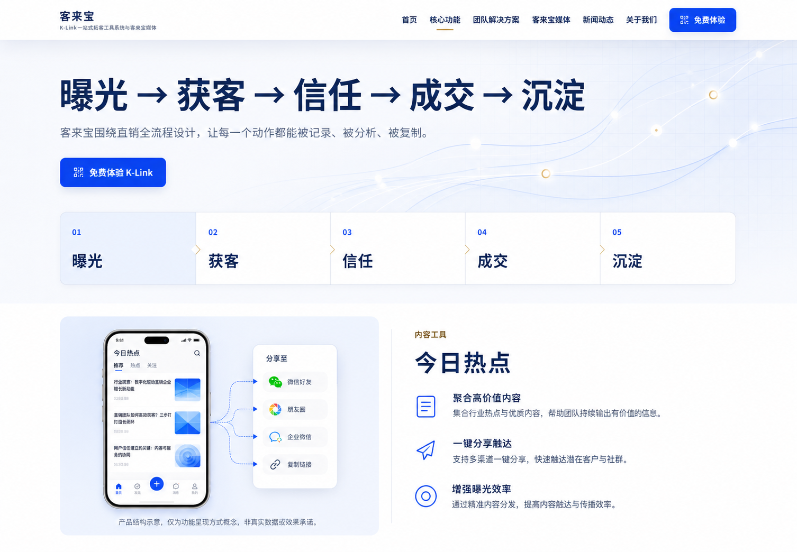
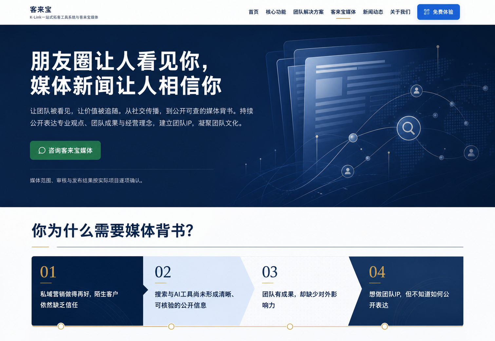
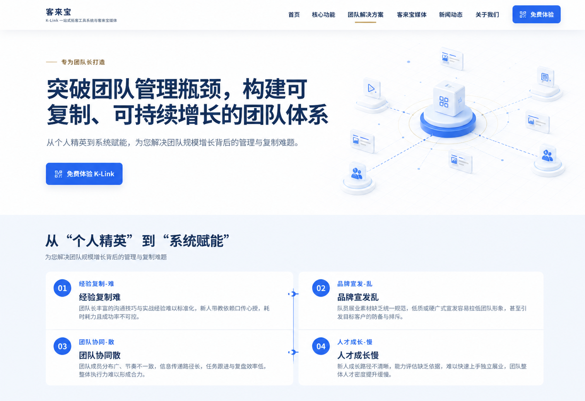

# FR-21 公开站完整视觉系统与可替换素材

- `FR-ID`: `FR-21`
- `标题`: 公开站完整视觉系统与可替换素材
- `所属阶段`: 阶段 4 - 现有官网体验完善
- `开发顺序`: 21
- `优先级`: P1
- `前置依赖`: `FR-16`、`FR-17`、`FR-18`、`FR-20`；流程门禁为 `FR-19` 及其交付 Sprint `sprint-m4-01` 完成并归档（两者是需求与交付计划的同一门禁映射，不是两个独立门禁）
- `计划 Sprint`: `sprint-m4-03`
- `交付状态`: 完成 / Local Code Ready / Production BLOCKED
- `涉及包`: `src/app` 公开页面与全局样式、`src/pages` 新闻/案例公开页面、`src/components` 公共站组件、`src/content` 静态内容、`public` 本地视觉素材、公开站契约与视觉回归测试、`docs/5-Evidence/m4-03`
- `是否属于原型阶段`: 否
- `来源类型`: 设计补强
- `原始 SRS 章节`: 第 4 节信息架构与路由、第 5.1～5.4 节公开站功能、第 8 节非功能需求、第 10～11 节验收与测试；本 FR 不改变 SRS 功能范围
- `相关 FR`: `FR-20` 官网视觉风格升级与回归保护
- `上游设计`: [客来宝统一中文官网视觉升级方案](../../../2-Design/Kelaibao-Website-Design-Proposal.md)
- `布局基线`: [客来宝官网内容、结构与布局设计规格 1.2](../../../2-Design/Kelaibao-Website-Content-and-Layout-Spec-v1.2.md)
- `视觉基线`: [客来宝统一中文官网视觉设计规格](../../../2-Design/Kelaibao-Unified-Website-Visual-Design-Spec.md)
- `概念参考`: [M4-03 概念图目录](../../../2-Design/assets/m4-03/concepts/)

## 目标

在 FR-20 已完成的视觉覆盖层基础上，把仍呈现为“框架和占位方框”的公开站升级为完整、可信、可持续替换素材的“可信增长网络”视觉系统，同时保持现有网站的文字内容、页面结构、路由、功能与业务边界不变。

本 FR 交付的不只是一次换色，而是可复用的字体、布局、组件、图像槽位、响应式和质量契约。公开页面应具备清晰的品牌识别、信息层级、视觉节奏和真实完成度；后续替换正式图片时不需要重新设计页面或改动内容结构。

## 背景与问题

M4-02 已完成全站基础换肤、视觉 Token 和回归保护，但现有页面仍有大量为背景图片、结构插图或彩色底色预留的框体。由于缺少完整字体系统、页面级构图和可替换素材机制，页面虽然结构完整，整体仍接近线框稿。

本轮需要在不重开 FR-20、不改变现有信息架构的前提下补齐完整视觉表达。概念图只锁定构图、色彩、字体、组件和素材语言；其中由图像模型生成的任何文字都不是文案来源，最终实现必须逐字使用现有代码中的用户可见文字。

### 已确认的设计效果图

以下七张效果图完整保存本轮设计探索。首页、功能页、媒体页以及标记为“修订版”的移动端和团队页效果图构成后续浏览器 fidelity QA 的当前对照基线；两个初版仅保留为设计演进记录，不覆盖修订版。图片中的生成文字、Logo、数据和界面细节不得直接作为实现内容，页面文字只允许来自当前源码。

#### 首页


#### 功能页



#### 媒体页



#### 移动端初版（设计演进记录）


#### 移动端修订版（当前基线）


#### 团队页初版（设计演进记录）



#### 团队页修订版（当前基线）


## 影响范围

### 用户可见范围

- 核心公开页：`/`、`/features`、`/team`、`/about`、`/media`、`/contact`。
- 政策页：`/privacy`、`/terms`、`/disclaimer`。
- CMS 公开页：`/news`、`/news/[slug]`、`/cases`、`/cases/[slug]`。
- Header、Footer、移动导航、按钮、卡片、Hero、Section、Dialog、二维码卡和内容列表。

### 只做回归验证的范围

- `/admin`、`/admin/login` 与受保护后台不进行品牌换肤。
- `/api/*`、`/health`、`/api/health`、RSS、sitemap 和 `llms.txt` 不改变输出契约。
- CMS、询盘、认证、数据库、OSS、DirectMail、ESA 和 Production 配置不改变行为。

### 文档与证据

- 更新 FR/Sprint 索引和设计资产引用。
- 在 `docs/5-Evidence/m4-03/` 保存冻结清单、四视口前后截图、浏览器验证记录和 fidelity ledger。

## 需求描述

### 1. 内容、结构与行为冻结

1. 所有现有 H1、H2、H3、正文、列表、链接、按钮、表单、Dialog、边界说明和可访问名称必须逐字不变。
2. 不新增营销口号、eyebrow、kicker、badge、pill、统计数字、客户 Logo、评价、排名、价格、Dashboard、产品结果或新 CTA。
3. 页面数量、路由、Header/Footer、导航顺序、Section 数量与顺序、内容分组、CTA 所属模块和 DOM 阅读顺序不变。
4. 桌面与移动端可以调整尺寸、间距和视觉比例，但不得改变内容归属、交互路径或移动端阅读顺序。
5. K-Link 免费体验继续只打开小程序二维码流程；客来宝媒体咨询继续只打开企业微信流程。
6. 移动菜单、焦点管理、Escape、Dialog、二维码失败降级、询盘、SSR、CMS 和发现能力保持现有行为。
7. 本 Sprint 唯一允许新增的可见非业务文字是 provisional 素材叠层，固定格式为 `建议尺寸 {width}×{height}`；它只存在于对应素材区域，`status="final"` 时必须消失。冻结 fixture 必须把该格式作为单独白名单，不得据此放宽其他文案断言。
8. 17 个素材的 `alt` 只允许使用第 7 节固定注册表中的获准字符串；加载失败态复用相同 `alt`，不得另造可见失败文案或可访问名称。allowed-copy inventory 必须分别记录现有源码文字、尺寸叠层格式和获准 `alt`。

### 2. 品牌风格与配色

视觉方向固定为“可信增长网络”：以深蓝建立企业可信度，以产品蓝表达 K-Link 行动，以媒体绿表达客来宝媒体子业务，通过网络关系线、柔和色块、结构插图和局部深色区域表现连接与增长。

| Token 语义 | 色值 | 使用边界 |
| --- | --- | --- |
| 主品牌深蓝 | `#102A56` | 核心标题、深色区和品牌锚点 |
| 提升蓝 | `#173A70` | 深色表面层次和 hover |
| 产品蓝 | `#2563EB` | K-Link 主 CTA、链接和产品强调 |
| 媒体绿 | `#0F6B50` | `/media` 业务语义与媒体咨询 CTA |
| 雾蓝背景 | `#F5F8FC`、`#EDF4FB` | 页面画布、Section 色带和结构插图背景 |
| 白色 | `#FFFFFF` | 主要表面与深色区反白文字 |
| 辅助文字 | `#52657D` | 正文次级信息与说明 |
| 关系线 | `#CBD7E8` | 网络连线、分隔和低强度边框 |
| 强调金 | `#C6A15B` | 少量可信度强调，不作为主 CTA |

- 不允许把全站改成暖白、米色或未经批准的新色温。
- `/media` 可使用绿色和局部深色构图，但必须共享客来宝 Header、Footer、字体、间距和组件体系，不得形成第二品牌。
- 颜色不能成为唯一的信息表达方式；正文、控件和状态必须满足现有可访问性阈值。

### 3. 字体系统

不引入远程 WebFont。页面、Dialog、表单和全部控件统一使用以下系统中文字体栈：

```css
font-family: -apple-system, BlinkMacSystemFont, "Segoe UI", "PingFang SC",
  "Hiragino Sans GB", "Microsoft YaHei", "Noto Sans CJK SC", Arial, sans-serif;
```

字体层级固定如下：

| 层级 | 桌面 | 移动 | 使用要求 |
| --- | --- | --- | --- |
| H1 | `60px / 1.08 / 750` | `40px / 1.12 / 750` | 每页主标题，控制行宽和断行 |
| H2 | `40px / 1.2 / 700` | `30px / 1.25 / 700` | Section 主标题 |
| H3 | `22–24px / 1.35 / 650` | `22px / 1.35 / 650` | 卡片与内容分组标题 |
| 大正文 | `18–19px / 1.75` | `17–18px / 1.75` | Hero 导语和重要说明 |
| 正文 | `16px / 1.8` | `16px / 1.75` | 长正文和列表 |
| 导航/按钮 | `15–16px / 650–700` | `15–16px / 650–700` | 所有交互控件显式定义 |
| 辅助信息 | `13–14px / 1.6` | `13–14px / 1.6` | 时间、标签和补充说明 |

- 中文标题与正文使用 `letter-spacing: 0`；仅独立的拉丁字母或数字 display 片段可使用 `-0.01em`，且必须通过 `320×568` 和 200% 缩放验证。不得依赖浏览器默认控件字体。
- 正文阅读宽度约 `38–46` 个中文字符；Hero 导语和政策长文分别设置适合的最大行宽。
- 中文标点不得孤立在行首；中英文与数字混排保持基线、空隙和字重一致。
- 层级必须同时通过字号、字重、行高、颜色和留白形成，不能只放大标题。

### 4. 页面布局与留白

- 主内容容器目标宽度约 `1200px`，保留安全边距并复用现有 Section/Container DOM。
- Section 垂直留白为桌面 `80–104px`、移动 `56–72px`，相邻区域通过背景色带、关系线和开放留白形成节奏。
- 桌面 Hero 建立明确的内容区与视觉区比例；移动端保持现有 DOM 顺序转为单列，视觉素材不得插入到错误的内容分组。
- 避免把所有内容包成相同白色卡片；根据现有结构选择开放布局、浅色带、边框卡或深色重点区。
- 视觉图片必须有稳定的 `aspect-ratio`、焦点位置和响应式裁切规则，加载前后不得引发明显布局跳动。

### 5. 组件样式

- Header 使用白底或透明度受控的浅色表面、细分隔线、明确当前项、sticky 层次和 `focus-visible`。
- 主按钮使用产品蓝实底；次按钮使用浅底或描边；媒体咨询使用媒体绿。hover、active、focus-visible、disabled 状态必须完整。
- 卡片使用轻边框、低强度阴影、统一圆角和清晰标题层级；同类组件必须共享 primitive 或明确 variant。
- Hero、功能模块、信息卡、内容列表、Dialog 和二维码卡共享统一的表面、边框、阴影与交互状态语言。
- 动效只允许颜色、透明度和轻微位移，禁止影响阅读顺序或造成大范围位移；必须支持 `prefers-reduced-motion`。
- 图标继续使用现有图标体系或生产级 SVG；不得以文本箭头或粗糙占位图形替代。

### 6. 页面级视觉要求

#### 首页 `/`

- Hero 使用“可信增长网络”结构插图增强第一屏，不改变现有标题、导语、CTA 或相邻区块预览。
- 四类工具各自配置统一风格的横向结构视觉，保持现有内容分组和顺序。
- 后续现有流程、价值、媒体摘要和边界内容通过色带、留白和连接关系形成连续节奏，不新增模块。

#### 功能页 `/features`

- 十项现有功能各配置 `900×1500` 纵向结构视觉，通过现有布局形成交替阅读节奏。
- 插图表达信息组织或功能关系，不得伪装成未经实现的 Dashboard 或真实客户数据。

#### 团队页 `/team`

- Hero 使用角色协作网络视觉，表达团队协同关系。
- 不生成虚构员工、办公室、团队合影、履历、客户或合作关系。

#### 媒体页 `/media`

- Hero 使用 `2400×1000` 横向媒体生态视觉，采用媒体绿与深蓝构图。
- 保留现有媒体咨询路径和边界表达，不增加 GEO 产品、第二 Logo 或第二导航。

#### 其余页面

- `/about`、`/contact`、政策页以及新闻/案例列表与详情页统一字体、内容宽度、卡片、链接和留白。
- CMS 内容仍由现有数据流服务端输出，视觉组件不得改变正文 HTML、metadata、canonical 或发布状态逻辑。

### 7. 可替换视觉素材

建立内部视觉素材注册表，最小类型契约为：

```ts
type VisualAssetStatus = "provisional" | "final";

interface VisualAssetDefinition {
  id: string;
  src: string;
  alt: string;
  width: number;
  height: number;
  status: VisualAssetStatus;
  focalPoint?: string;
}
```

- `VisualAssetDefinition` 只属于前端内部，不新增公开 API、CMS 字段、数据库字段或运行时远程配置。
- 图片必须位于仓库 `public` 目录并优先使用 WebP；公开页面不得向远程图片服务发请求。
- `width`、`height` 和容器 `aspect-ratio` 必须一致，`focalPoint` 用于跨视口裁切。
- `status="provisional"` 时，公开页面必须在图片区域以明显大字叠层显示建议尺寸；切换为 `final` 后自动隐藏尺寸提示。
- 图片加载失败时保留尺寸稳定的低干扰底色和替代文本，不隐藏相邻业务内容。

素材清单：

| 槽位 | 数量 | 建议尺寸 | 初始状态 |
| --- | ---: | --- | --- |
| 首页 Hero | 1 | `1600×1200` | `provisional` |
| 首页四类工具 | 4 | 各 `1200×800` | `provisional` |
| 十项功能视觉 | 10 | 各 `900×1500` | `provisional` |
| 团队 Hero | 1 | `1600×1000` | `provisional` |
| 媒体 Hero | 1 | `2400×1000` | `provisional` |

固定注册表映射如下。`src` 是公开路径，仓库文件必须位于对应的 `public/visual/m4-03/` 路径；所有初始素材均为 `provisional`，不得通过改为 `final` 隐藏尚未完成的素材状态。

| ID | 路由 / 内容组 | `src` | 尺寸 | `focalPoint` | 获准 `alt` |
| --- | --- | --- | --- | --- | --- |
| `home-hero` | `/` Hero | `/visual/m4-03/home/home-hero.webp` | `1600×1200` | `50% 50%` | `K-Link 从内容触达到持续连接的可信增长网络结构示意` |
| `home-tool-content` | `/` 内容工具 | `/visual/m4-03/home/tool-content.webp` | `1200×800` | `50% 50%` | `内容工具从信息整理到社群分享的结构示意` |
| `home-tool-showcase` | `/` 展示工具 | `/visual/m4-03/home/tool-showcase.webp` | `1200×800` | `50% 50%` | `展示工具连接个人信息与传播素材的结构示意` |
| `home-tool-team` | `/` 团队工具 | `/visual/m4-03/home/tool-team.webp` | `1200×800` | `50% 50%` | `团队工具连接品牌内容与成员协作的结构示意` |
| `home-tool-growth` | `/` 引流工具 | `/visual/m4-03/home/tool-growth.webp` | `1200×800` | `50% 50%` | `引流工具连接资源发现与社群触达的结构示意` |
| `feature-today-hotspot` | `/features` 今日热点 | `/visual/m4-03/features/today-hotspot.webp` | `900×1500` | `50% 45%` | `今日热点内容聚合与分享路径结构示意` |
| `feature-daily-health` | `/features` 每日健康 | `/visual/m4-03/features/daily-health.webp` | `900×1500` | `50% 45%` | `每日健康内容整理与持续传播结构示意` |
| `feature-future-weekly` | `/features` 未来周报 | `/visual/m4-03/features/future-weekly.webp` | `900×1500` | `50% 45%` | `未来周报内容编排与周期触达结构示意` |
| `feature-business-insight` | `/features` 商业洞察 | `/visual/m4-03/features/business-insight.webp` | `900×1500` | `50% 45%` | `商业洞察信息组织与观点传播结构示意` |
| `feature-digital-card` | `/features` 数字名片 | `/visual/m4-03/features/digital-card.webp` | `900×1500` | `50% 45%` | `数字名片信息呈现与连接路径结构示意` |
| `feature-promotion-poster` | `/features` 推广海报 | `/visual/m4-03/features/promotion-poster.webp` | `900×1500` | `50% 45%` | `推广海报内容组合与分享路径结构示意` |
| `feature-brand-journal` | `/features` 品牌专刊 | `/visual/m4-03/features/brand-journal.webp` | `900×1500` | `50% 45%` | `品牌专刊统一内容与成员传播结构示意` |
| `feature-team-mini-program` | `/features` 团队小程序 | `/visual/m4-03/features/team-mini-program.webp` | `900×1500` | `50% 45%` | `团队小程序连接品牌、成员与访客的结构示意` |
| `feature-resource-market` | `/features` 资源集市 | `/visual/m4-03/features/resource-market.webp` | `900×1500` | `50% 45%` | `资源集市分类发现与需求连接结构示意` |
| `feature-network-circle` | `/features` 人脉社群圈 | `/visual/m4-03/features/network-circle.webp` | `900×1500` | `50% 45%` | `人脉社群圈关系发现与社群连接结构示意` |
| `team-hero` | `/team` Hero | `/visual/m4-03/team/team-hero.webp` | `1600×1000` | `50% 50%` | `团队内容、成员协作与品牌传播关系网络示意` |
| `media-hero` | `/media` Hero | `/visual/m4-03/media/media-hero.webp` | `2400×1000` | `62% 50%` | `客来宝媒体从专业表达连接公开传播渠道的生态示意` |

注册表验证必须 fail-closed：拒绝远程 URL、缺失本地文件、未经显式豁免的非 WebP、未知状态、非正整数尺寸、声明尺寸与文件尺寸或容器宽高比不一致、重复 ID、缺失上述任一槽位或未登记 `alt`。

### 8. 桌面端与移动端

- 基准视口为 `390×844`、`768×1024`、`1280×800`、`1440×900`；另按项目规则检查 `320px` 最小宽度。
- 桌面端允许内容/视觉双栏和交替构图，但不能改变现有 Section/Grid 契约。
- 平板和移动端统一为稳定单列，按钮触控尺寸、导航展开、Dialog 可视范围和图片裁切必须可用。
- 页面不得出现横向滚动、文字裁切、素材遮挡、固定元素覆盖正文或移动阅读顺序变化。
- 200% 缩放下核心内容和操作仍可访问，不要求恢复桌面列数。

## 高层要求

- 客来宝继续作为唯一主品牌；K-Link 是产品，客来宝媒体是 `/media` 内子业务。
- 延续现有 Next.js、React、TypeScript、CSS/Tailwind 构建链和组件边界，不引入第二套 UI 框架、运行时主题系统或远程字体。
- App Router 与 Pages Router 必须共享设计系统但保持运行时边界；后台不得被公开站视觉规则污染。
- 所有第三方集成继续直接使用明确 HTTP(S) API，不创建通用 `webservice`。
- Production 仍固定为 ESA → Function Compute → RDS MySQL + 私有 OSS；本 FR 不改变任何生产门禁。
- FR-19 是需求标识，M4-01 是交付该需求的 Sprint；二者共同指向同一流程门禁。该门禁已由提交 `2583ff4` 完成并归档。M4-03 的文档 review-confirm 已于 2026-08-02 完成，代码实施可以开始。

## 输入

- 现有公开站源码、内容常量、路由、组件和交互行为。
- 已保存的七张设计效果图；其中首页、功能页、媒体页、移动端修订版和团队页修订版作为当前视觉参考，两个初版作为演进记录。
- 本 FR 中锁定的色彩、字体、布局、组件和素材规格。
- 素材注册表中的本地图片路径、尺寸、替代文本、状态和焦点位置。

不接受来自 URL、Cookie、CMS 或远程服务的主题、素材状态或视觉变体输入。

## 输出

- 完整的公开站视觉 Token、字体层级、组件样式和页面构图。
- 可复用的内部 `VisualAssetSlot` 组件与本地资产注册表。
- 首页、功能页、团队页和媒体页的结构插图及可替换槽位。
- 覆盖所有公开页面的响应式和可访问性实现。
- `docs/5-Evidence/m4-03/` 下可复核的冻结基线、before/after、fidelity ledger 与验证记录。

## 失败与降级

- Provisional 图片缺失或加载失败时保留稳定尺寸、建议尺寸提示和替代文本；不得隐藏业务内容或请求远程兜底图。
- 单张图片无法达到最终质量时保持 `provisional`，不得通过把状态改为 `final` 隐藏尺寸提示。
- reduced-motion 环境禁用非必要位移与过渡，不影响信息理解。
- 浏览器不支持局部增强 CSS 时仍应保持内容可读、CTA 可操作和布局无横向溢出。
- 任意文字、路由、DOM/Section、交互或 CMS/发现契约发生变化时验收失败，回退视觉接线并修复，不接受以“视觉需要”为理由豁免。

## 不纳入范围

- 修改、优化或新增任何营销文案、导航、CTA、页面、Section 或业务功能。
- 管理后台换肤、CMS 类型扩展、数据库或 API 变更。
- 新增客户 Logo、客户评价、统计数据、排名、价格、产品结果或真实 Dashboard 暗示。
- 生成虚构员工、办公室、客户、合作伙伴或媒体背书素材。
- 远程 WebFont、远程图片 CDN、图片 SaaS、运行时主题编辑器或通用页面 CMS。
- 用本 Sprint 的截图或本地测试关闭备案、云资源、恢复、内容授权或 Production 门禁。

## 最小验证方式

文档阶段：

- `git diff --check`
- FR/Sprint 编号、相对链接、索引状态和依赖顺序检查
- 对照 Sprint Workflow acceptance gates 完成文档 review 与 review-confirm

实施阶段：

- `pnpm test && pnpm lint && pnpm build`
- 用户可见文字 fixture、公开路由、DOM/Section 顺序和交互契约测试
- 注册表完整性与负向测试：远程 URL、缺失文件、非 WebP、非法状态/尺寸、宽高比不一致、重复 ID、缺失槽位和未登记 `alt` 均必须失败
- `320×568`、`390×844`、`768×1024`、`1280×800`、`1440×900` 前后截图；补充 200% 缩放检查
- 键盘、焦点、Escape/焦点恢复、移动菜单、Dialog、reduced motion 和图片失败降级验证
- 概念图与最新实现截图分别通过图像检查并形成 fidelity ledger；只比较构图、区域比例、字体层级、配色、素材语言、留白、响应式和交互状态。概念图中的生成文字、Logo、数据、指标和新控件区域必须遮罩或标记为忽略，并由 allowed-copy/no-new-claim fixture 独立验证

## 验收要点

- 全站使用锁定的“可信增长网络”配色、字体、布局和组件体系，页面不再呈现为未完成线框稿。
- 用户可见文字逐字一致；无新增营销文案、指标、Logo、评价或产品结果。
- 路由、Section 数量/顺序、内容分组、CTA、Dialog、移动菜单、CMS 和业务功能无变化。
- 首页 Hero、四类工具、十项功能、团队 Hero 和媒体 Hero 均有符合规格的本地结构视觉。
- 所有 `provisional` 素材在公开页面明显显示建议尺寸；`final` 素材不显示尺寸提示。
- 四个基准视口及 `320px` 无横向溢出、裁切、遮挡或阅读顺序变化。
- 200% 缩放、键盘、焦点、Escape、reduced motion 和颜色对比通过。
- App Router、Pages Router、后台、API、CMS、SSR 和发现文件无回归。
- `pnpm test && pnpm lint && pnpm build` 全部通过，浏览器 fidelity QA 和代码 review-confirm 完成。
- 交付最多标记为 `Local Code Ready`；Production 状态继续由既有外部门禁决定。

## 备注

- FR-20/M4-02 保持已完成和归档状态，本 FR 不重写其历史结论。
- 七张设计效果图完整保存设计演进；当前基线仅锁定视觉方向，图中生成文字、数据和 Logo 不得进入实现。
- M4-01 已于提交 `2583ff4` 完成并归档；FR-21/M4-03 已完成文档与代码双模型评审、review-confirm、全量本地验证和证据归档。
- 用户显式委托 Sprint Workflow 即视为标准 document/code `review-start` 的 reviewer 授权；仅增加标准流程之外的 reviewer 或扩大评审范围时需要再次取得人工确认。2026-08-02 本轮授权与决定记录见对应 review-confirm 文档。
- 文档创建日期：`2026-08-02`。
